# Guide: a Mongoose Form with an HTML/JS/CSS page, a C# script and an IDO

How the pieces of a "web page inside a Form" app are built in the Web Designer, and how they call each other at runtime.

Built and proven in this tenant by:
- EXP-134: the FX_InventoryItems IDO and table;
- EXP-136: the FX_InventoryDashboard Form;
- EXP-149 to EXP-151: the FX_ApiPage page on FX_ApiProbe, which calls APIs.

Knowledge state: **observed**. Each step worked at runtime once, with same-session evidence. Replacing an existing asset's content is **verified** (EXP-139, BLD-001). The build playbook is `.claude/skills/mongoose-builder/playbooks/web-user-controls.md`.

Screenshots are from the operator's account in User scope. They show tenant and account identifiers, so keep this guide inside the repo.

---

## 1. The big picture

There are five pieces. Only the Form and its script are User scope; the IDO, table, asset and variable are tenant-wide objects.

| # | Piece | Where it lives | Job |
|---|---|---|---|
| 1 | **SQL table + IDO** (e.g. `FX_InventoryItems`) | Data Maintenance Wizard / IDOs form | The data, exposed as properties |
| 2 | **Form** (e.g. `FX_InventoryDashboard`) | Web Designer, Script Language = Visual C# | The container the user opens |
| 3 | **Web User Control Asset** (e.g. `FX_Inventory/index.html`) | Edit › Web User Control Assets | The HTML/CSS/JS page |
| 4 | **UserControl component** (e.g. `FX_InventoryControl`) | A component on the Form | Shows the asset in an iframe on the Form |
| 5 | **C# form script** + a **Global variable** (e.g. `FX_vInventoryJson`) | Edit › Form Script / Edit › Variable | Server-side code; the variable carries its result back to the page |

### Runtime call flow

```
 Browser (UserControl iframe)                      Mongoose server (form script, C#)
 ────────────────────────────                      ─────────────────────────────────
 index.html: user clicks "Refresh"
   WSForm.invoke("FX_LoadInventoryFromIDO", cb) ──► public void FX_LoadInventoryFromIDO()
                                                      IDOClient.LoadCollection("FX_InventoryItems", ...)  ──► IDO ──► SQL table
                                                      (or IDOClient.Invoke("IONAPIMethods", ...)          ──► ION API, SSO)
                                                      (or HttpWebRequest                                   ──► external HTTPS)
                                                      ThisForm.Variables("FX_vInventoryJson").Value = json
   cb() runs ◄──────────────────────────────────────  method returns
   WSForm.getVarValue("FX_vInventoryJson", fn) ───►  reads the variable
   fn(value): JSON.parse(value) → render table ◄───
```

Key rules:
- **The page never talks to the IDO or the API directly.** It only calls a C# method by name with `WSForm.invoke`. All data access and every outbound call happen in C# on the server, so no token or credential reaches the browser.
- **Read the result through the variable, not the invoke callback.** In EXP-131/132 the callback's value came back as `0`. `WSForm.getVarValue` returned the real value.
- `WSForm` exists only when the page runs inside its Form. The page's `../$app/scripts/UserControl.js` include provides it.

---

## 2. Step 1: the table and the IDO (Data Maintenance Wizard)

Create the SQL table and the IDO together in the **Data Maintenance Wizard**:
- IDO name `FX_…`;
- project `FX_HelloWorldProject01`;
- a table alias;
- one row per field (name, type, length, key).

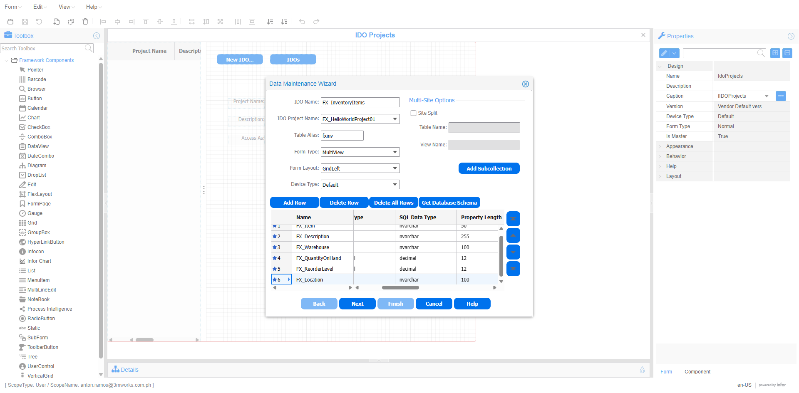

*Shows:* Data Maintenance Wizard page 1 with IDO Name FX_InventoryItems, project FX_HelloWorldProject01, table alias `fxinv` and the six field rows, before Next.

After the wizard, check the IDO in the **IDOs** form › Properties tab. Every column should be a bound property.

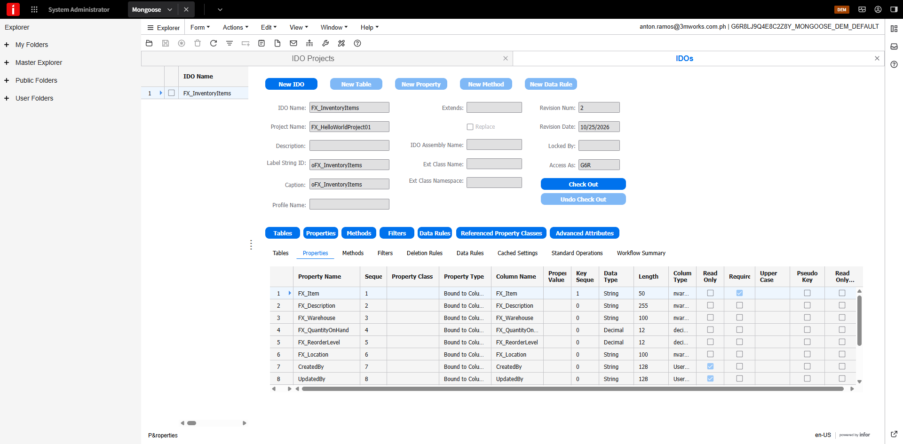

*Shows:* FX_InventoryItems reopened, with its properties bound to the table columns.

These property names are what the C# `LoadCollection` call asks for (step 5). See `playbooks/data-layer.md` for joins and derived fields.

---

## 3. Step 2: the Form (Build From Scratch, Visual C#)

In the Web Designer, **Form Wizard › Build From Scratch**, then Name `FX_<App>`.

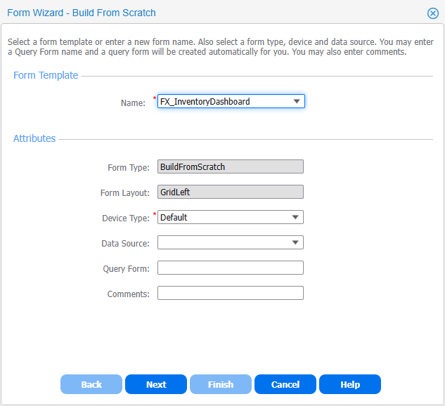

*Shows:* the wizard with the name filled in, before Finish.

Then set the Form's **Behavior › Script Language = Visual C#**. Click the option and press Tab so it commits. The C# script in step 5 needs this.

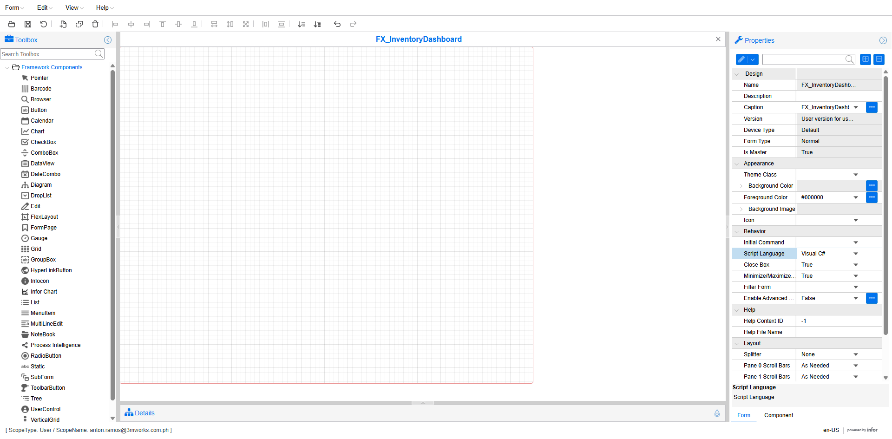

*Shows:* Script Language reads Visual C# after the field lost focus.

---

## 4. Step 3: the Global variable (the return channel)

**Edit › Variable** → Global Objects → blue **+** → Name `FX_v<Name>` → OK → Global Objects OK.

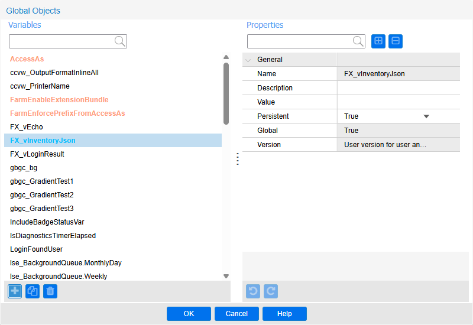

*Shows:* the new variable FX_vInventoryJson with **Persistent = True** and **Global = True**.

C# writes this variable and JS reads it. C# accesses it with `ThisForm.Variables("FX_vInventoryJson")`.

---

## 5. Step 4: the HTML/CSS/JS page (Web User Control Asset)

**Edit › Web User Control Assets** → Global Objects (Web Assets tree) → leftmost **+** (New) → Name `FX_<App>/index.html` → Tab → OK. This creates the folder `FX_<App>` with the file `index.html` in it.

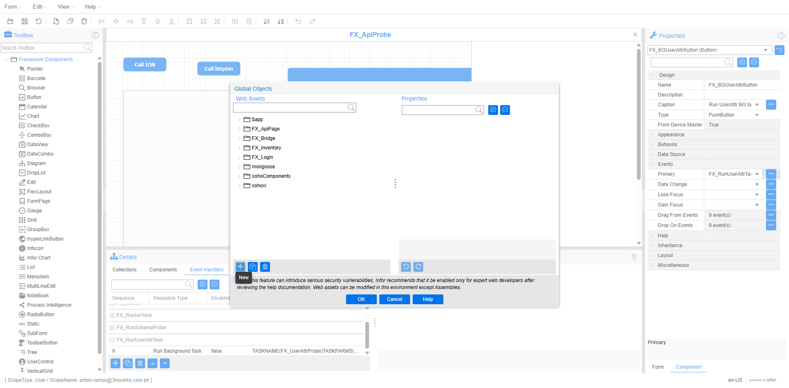

*Shows:* the Web Assets tree with FX_ApiPage created, and the New (+) button tooltip.

Select the file → Content row **"…"** (Open Edit Property Dialog) → **Edit Browser File**. Mongoose's template already contains the `UserControl.js` include. Keep it; it's what defines `WSForm`.

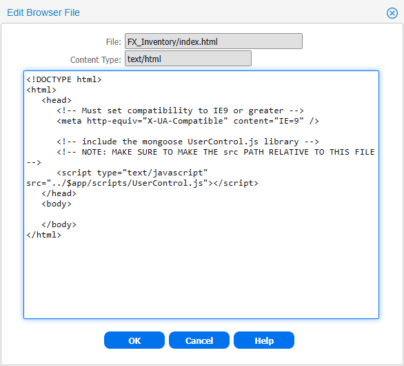

*Shows:* the generated template, including `<script src="../$app/scripts/UserControl.js">`.

Replace the content with your page in one paste:
1. Edit it locally in `assets/FX_<App>/index.html`.
2. Install the flush-left copy `index.flat.html`.
3. Read it back with `tools/compare-readback.js`.
4. **Edit Browser File OK** → **Global Objects OK** → Designer **Save**.

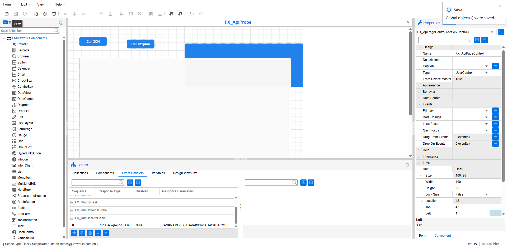

*Shows:* the save notice "Global object(s) were saved.", which is what you see when only an asset changed.

Keep all CSS and JS inline, or in other `FX_` assets. The tenant should not depend on an external CDN.

### Minimal page skeleton (from `assets/FX_Inventory/index.html` and `assets/FX_ApiPage/index.html`)

```html
<!DOCTYPE html>
<html lang="en">
<head>
<meta charset="utf-8">
<script type="text/javascript" src="../$app/scripts/UserControl.js"></script>
<style>
  body{font-family:Segoe UI,Arial,sans-serif;padding:16px}
  #FX_Status.FX_Error{color:#b42318}
</style>
</head>
<body>
<button type="button" id="FX_BtnLoad">Refresh</button>
<div id="FX_Status" role="status">Ready.</div>
<table id="FX_Table"><tbody></tbody></table>
<script type="text/javascript">
(function () {
  var statusLine = document.getElementById("FX_Status");
  function setStatus(t, err) { statusLine.textContent = t; statusLine.className = err ? "FX_Error" : ""; }

  function load() {
    if (typeof WSForm === "undefined") {          // page opened outside its Form
      setStatus("Open this page inside the FX_InventoryDashboard Form.", true);
      return;
    }
    setStatus("Loading...");
    var timer = setTimeout(function () { setStatus("No response after 20 s.", true); }, 20000);
    WSForm.invoke("FX_LoadInventoryFromIDO", function () {          // 1. run the C# method
      WSForm.getVarValue("FX_vInventoryJson", function (value) {     // 2. read its result
        clearTimeout(timer);
        var rows = JSON.parse(value);                                // 3. render
        var body = document.querySelector("#FX_Table tbody");
        body.innerHTML = "";
        rows.forEach(function (r) {
          var tr = document.createElement("tr");
          ["Item", "Description", "QuantityOnHand"].forEach(function (c) {
            var td = document.createElement("td"); td.textContent = r[c]; tr.appendChild(td);
          });
          body.appendChild(tr);
        });
        setStatus("Loaded " + rows.length + " records");
      });
    });
  }
  document.getElementById("FX_BtnLoad").addEventListener("click", load);
})();
</script>
</body>
</html>
```

**Passing arguments:** `WSForm.invoke("FX_CallWmGet", path, cb)` or `WSForm.invoke("FX_ListShipments", "0", "25", cb)`. The arguments arrive as strings in the C# method's parameters, in order (EXP-133/138/150/151).

---

## 6. Step 5: the C# form script

Open **Edit › Form Script** (Script Editor) and paste the whole class. Then:
1. Compile with ▶.
2. Expand **Compile Result** and look for "Built with 0 errors".
3. Click OK, then Save.

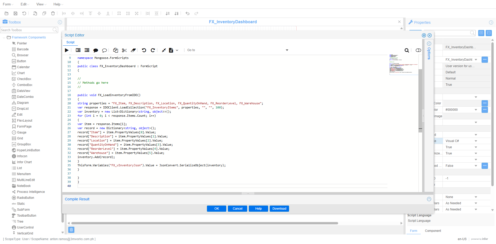

*Shows:* the C# class with `IDOClient.LoadCollection` and the `ThisForm.Variables("FX_vInventoryJson")` line, before OK.

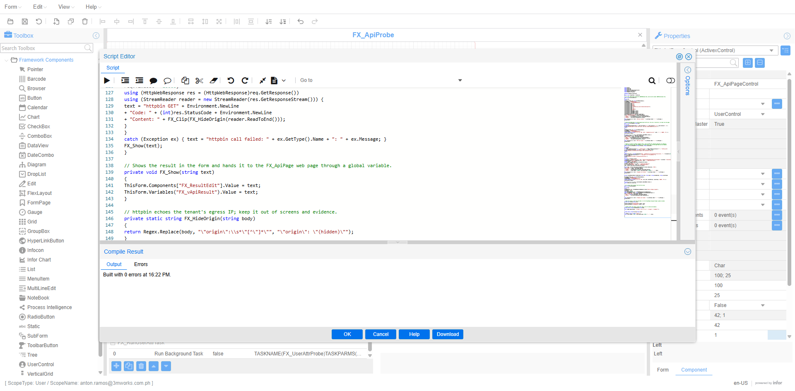

*Shows:* Compile Result "Built with 0 errors" (FX_ApiProbe script).

![Save notice "Form [FX_ApiProbe] and global object(s) were saved."](../../../evidence/EXP-151/02-script-saved.png)

*Shows:* the Save notice "Form [FX_ApiProbe] and global object(s) were saved."

**Paste the code flush-left, with no indentation** (keep a `.flat.cs.txt` copy). The editor auto-indents, and indented sources overflow a column, so Save fails with "String or binary data would be truncated" (EXP-138). Typing the code instead of pasting it auto-closes braces.

A clean compile is weak evidence. Only the runtime result proves the script works.

### A. Read an IDO (`assets/FX_Inventory/FX_InventoryDashboard.cs.txt`)

```csharp
using System;
using System.Collections.Generic;
using Mongoose.Scripting;
using Newtonsoft.Json;

//<Ref>Newtonsoft.Json.dll</Ref>

namespace Mongoose.FormScripts
{
    public class FX_InventoryDashboard : FormScript
    {
        public void FX_LoadInventoryFromIDO()
        {
            string properties = "FX_Item, FX_Description, FX_Location, FX_QuantityOnHand, FX_ReorderLevel, FX_Warehouse";
            var response = IDOClient.LoadCollection("FX_InventoryItems", properties, "", "", 100);   // IDO, props, filter, order, max rows
            var inventory = new List<Dictionary<string, object>>();
            for (int i = 0; i < response.Items.Count; i++)
            {
                var item = response.Items[i];
                var record = new Dictionary<string, object>();
                record["Item"] = item.PropertyValues[0].Value;          // index = position in the properties string
                record["Description"] = item.PropertyValues[1].Value;
                // ...
                inventory.Add(record);
            }
            ThisForm.Variables("FX_vInventoryJson").Value = JsonConvert.SerializeObject(inventory);
        }
    }
}
```

- The class name matches the Form name, and the class derives from `FormScript` in namespace `Mongoose.FormScripts`.
- Methods the page calls must be `public`.
- `//<Ref>Newtonsoft.Json.dll</Ref>` makes `JsonConvert` available.
- `PropertyValues[i]` follows the order of the property list. Keep the two in sync.
- In a filter, escape `'` as `''` (as `FX_LoginPortal` does).

### B. Call an Infor ION API (`assets/FX_ApiProbe/FX_ApiProbe.cs.txt`)

```csharp
InvokeRequestData req = new InvokeRequestData();
req.IDOName = "IONAPIMethods";
req.MethodName = "InvokeIONAPIMethod2";
// 0 SSO "1", 1 server "1", 2 suite "WM", 3 verb, 4 path (with query string), 5 MethodParams "",
// 6 content type, 7 timeout ms, 8 binary "0"; then 4 outputs: 9 code, 10 body, 11 headers, 12 infobar
foreach (string p in new[] { "1", "1", "WM", "GET", "/wmwebservice_rest" + path, "", "", "20000", "0" }) req.Parameters.Add(p);
for (int i = 0; i < 4; i++) req.Parameters.Add(IDONull.Value);
InvokeResponseData res = IDOClient.Invoke(req);
string text = "Code: " + res.Parameters[9].Value + Environment.NewLine + "Content: " + res.Parameters[10].Value;
ThisForm.Variables("FX_vApiResult").Value = text;
```

- With SSO = 1, Mongoose handles authentication on the server for the signed-in user. No token appears in the code or the browser.
- Parameter 5 (`MethodParams`) is a JSON array of `RestMethodParameter`, not a request body. Put query strings in the path.
- The WM `{warehouse}` path parameter is the facility's full `db_name` from `GET /enterprise/facilities`.

### C. Call an external HTTPS API

`HttpWebRequest` GET works from a form script (EXP-144, `FX_CallHttpbin`):
- wrap it in try/catch;
- clip the body;
- mask anything sensitive (e.g. httpbin's `origin` IP) before writing it to the variable.

---

## 7. Step 6: the UserControl component (puts the page on the Form)

1. Toolbox **UserControl** → click the canvas → Name `FX_<App>Control` (it commits when the field loses focus).
2. Specific Attributes › **User Control Name** "…" → **Edit User Control References** → tick **Use Web Control** → **Control URL** = pick `FX_<App>/index.html` → OK.

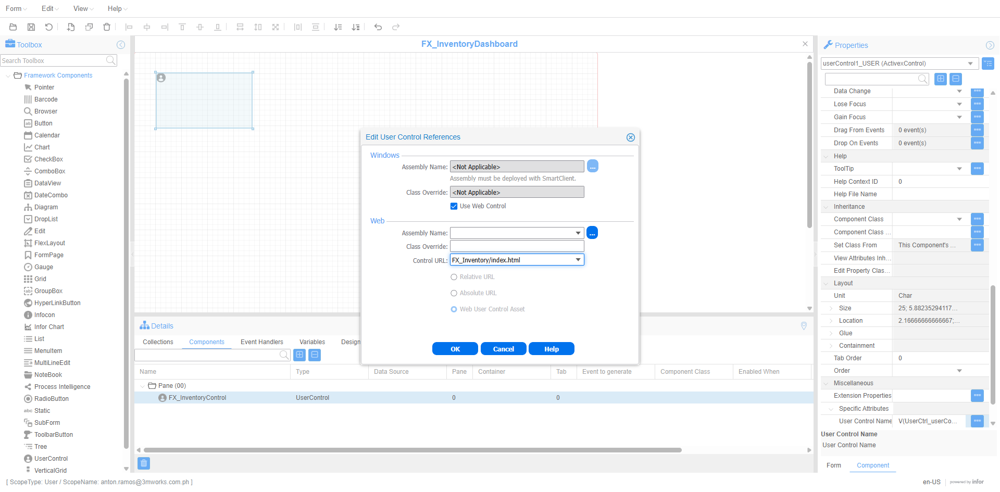

*Shows:* Use Web Control ticked, with Control URL `FX_Inventory/index.html` picked from the list.

3. Set **Layout › Size** large enough. The default of about 184×106 px is cramped. The dashboard uses `100; 30`; FX_ApiPageControl uses `100; 25` at Location `42; 1`.

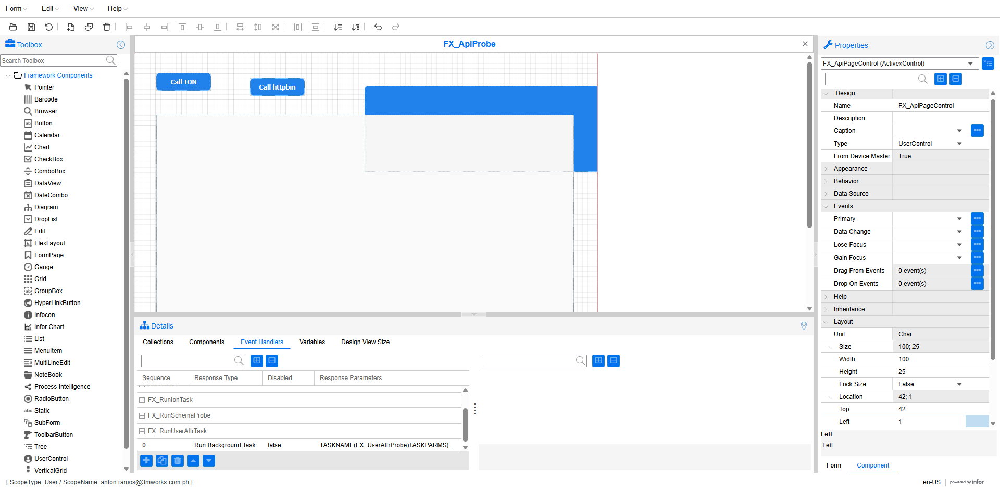

*Shows:* the UserControl's Layout Size and Location in the property grid.

4. **Save.** The component then appears in the Form's components list.

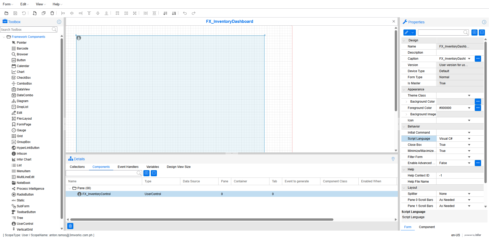

*Shows:* FX_InventoryControl (UserControl) listed in the Components grid after Save. The save notice is not visible in this capture.

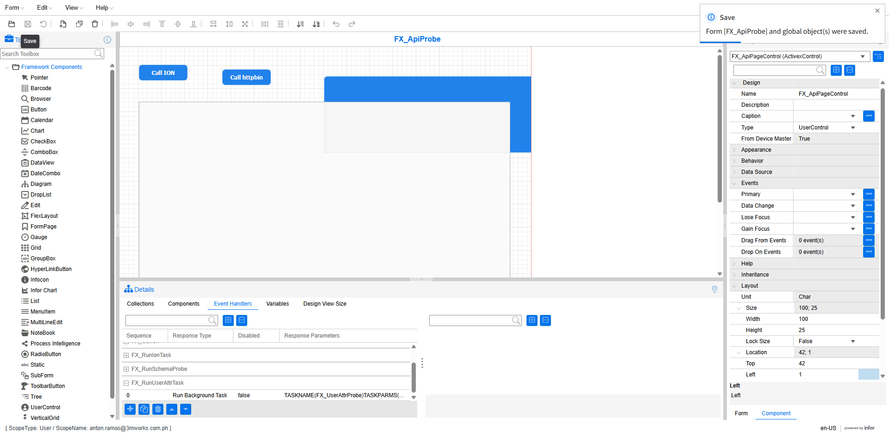

*Shows:* the save notice after FX_ApiPageControl was added to FX_ApiProbe.

The Designer creates `UserCtrl_*`, `UserCtrlAsm_*` and `UserCtrlUrl_*` form variables by itself. Leave them alone.

---

## 8. Step 7: run it

In the Web Client, open the Form with **Open › Select Form**. A brand-new Form shows in that list only after the Web Client page is reloaded. Then click the page's button.

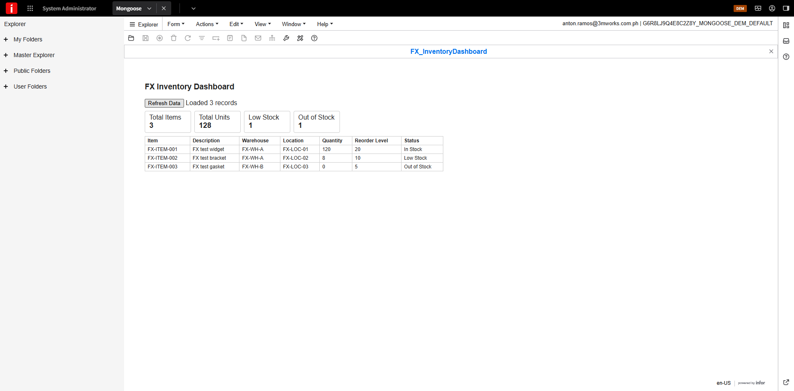

*Shows:* the IDO route working: FX_InventoryDashboard at runtime, status "Loaded 3 records", KPI cards and a table of the 3 FX_InventoryItems rows.


*Shows:* the ION route: the page's result box shows Code 200 and "Hello World!" from the WM helloworld method.

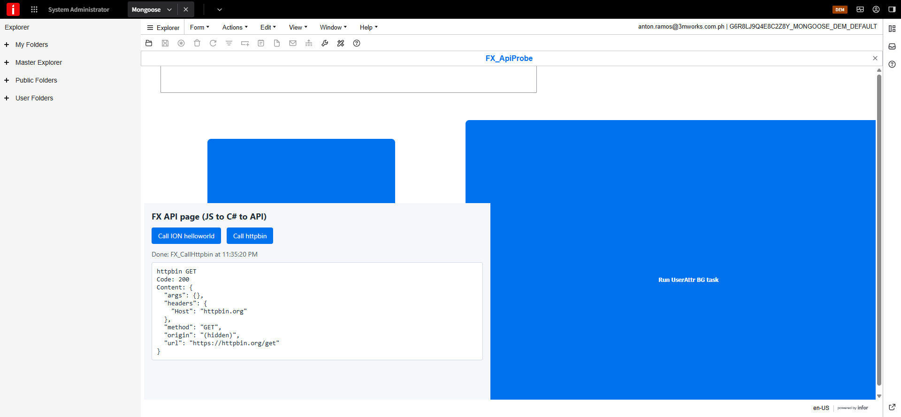

*Shows:* the external route: httpbin GET with Code 200, `origin` masked.

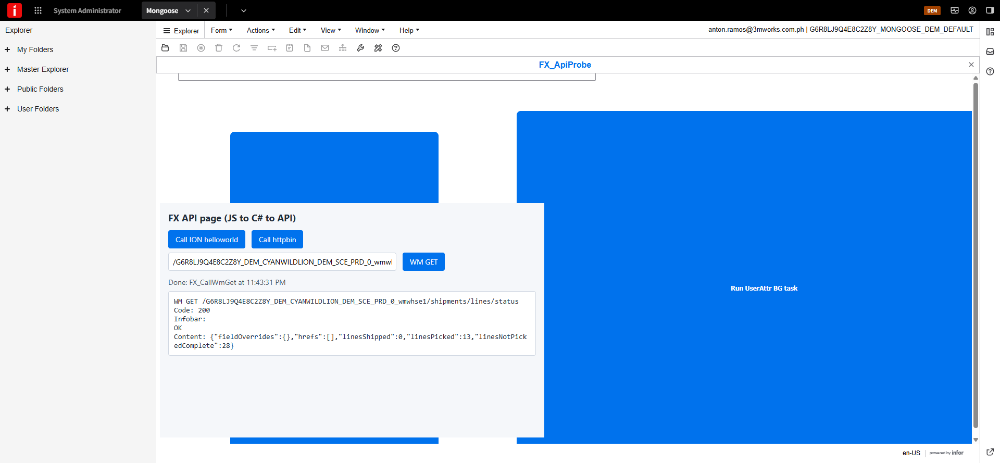

*Shows:* a WM REST GET typed into the page's path box (`/{warehouse}/shipments/lines/status`), returning Code 200 with line counts (EXP-150). The blue blocks are the old BG buttons overlapping the page (gotcha 6).

---

## 9. Who calls whom: a summary

| From | To | How | Example |
|---|---|---|---|
| UserControl component | Asset page | Control URL `FX_<App>/index.html` | `FX_InventoryControl` → `FX_Inventory/index.html` |
| Page (JS) | C# method | `WSForm.invoke("FX_Method", [args...,] cb)` | `invoke("FX_ListShipments", "0", "25", cb)` |
| C# | IDO / SQL table | `IDOClient.LoadCollection(ido, props, filter, order, max)` | `FX_InventoryItems` |
| C# | Infor ION API | `IDOClient.Invoke` on `IONAPIMethods.InvokeIONAPIMethod2` (SSO) | WM helloworld, shipments |
| C# | External web | `HttpWebRequest` | `https://httpbin.org/get` |
| C# | Page | writes the Global variable `ThisForm.Variables("FX_v…").Value` | `FX_vInventoryJson`, `FX_vApiResult` |
| Page (JS) | Result | `WSForm.getVarValue("FX_v…", fn)` | `JSON.parse(value)` → render |

---

## 10. Gotchas (all hit in this tenant)

1. **The invoke callback's value is not the result.** Always read the variable.
2. **Keep the `UserControl.js` include**, and guard with `typeof WSForm === "undefined"` so the page can be previewed locally with mock data.
3. **Flush-left C#.** Indented paste → Save fails with "String or binary data would be truncated".
4. **Add a timeout and a status line** on every invoke (20 s used), so a server error doesn't leave the page silently stuck.
5. **Size the payload.** Pages of 25 WM orders (about 6 KB each, so about 150 KB) passed through the variable and parsed; the C# side caps the text at 200 KB. Larger sizes are untested. Render chosen columns only, never raw JSON with contact data.
6. **Overlapping components.** Other components on the Form can sit on top of the iframe and intercept clicks. On FX_ApiProbe, the old "Run … BG task" buttons cover part of FX_ApiPage.
7. **Session expiry.** The Designer session lapses about hourly. "Server event processing returned an error" means: re-login and reload; don't retry blindly.
8. **Assets are tenant-wide** and readable by tenant users. Never put secrets in them, and never edit `$app`, `mongoose` or `soho*` assets.
9. **A new Form appears in Select Form** only after the Web Client page is reloaded.

## 11. Knowledge states

| Item | State | Source |
|---|---|---|
| Data Maintenance Wizard → table + IDO | observed | EXP-134 |
| Build From Scratch Form + Visual C# | observed | EXP-136 |
| Global variable as the return channel | observed | EXP-131/132/136 |
| Asset create + UserControl wiring | observed | EXP-131/136/149 |
| Replacing an existing asset's content | **verified** | EXP-139, BLD-001 |
| JS → C# → IDO (LoadCollection) | observed | EXP-136 |
| JS → C# → ION API GET (SSO) | observed | EXP-149/150 |
| JS → C# → ION list POST (one approved endpoint) | observed | EXP-151 |
| JS → C# → external HTTPS GET | observed | EXP-144/149 |
| Writing to an IDO from the page (UpdateCollection) | not covered here | — |
| POST with a request body to ION | unverified | — |
